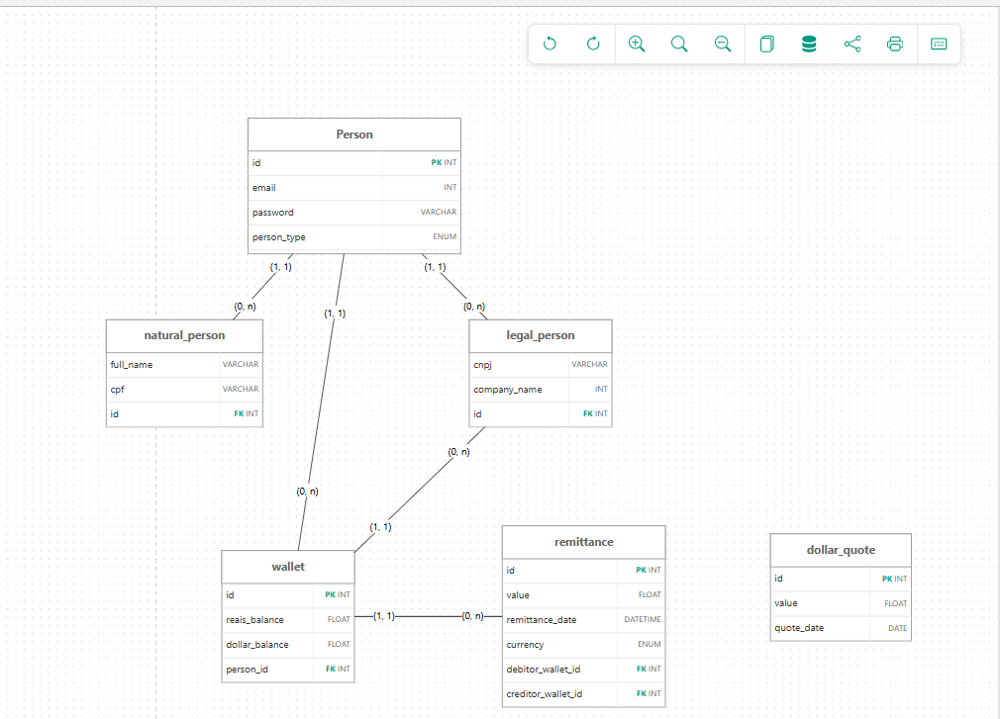
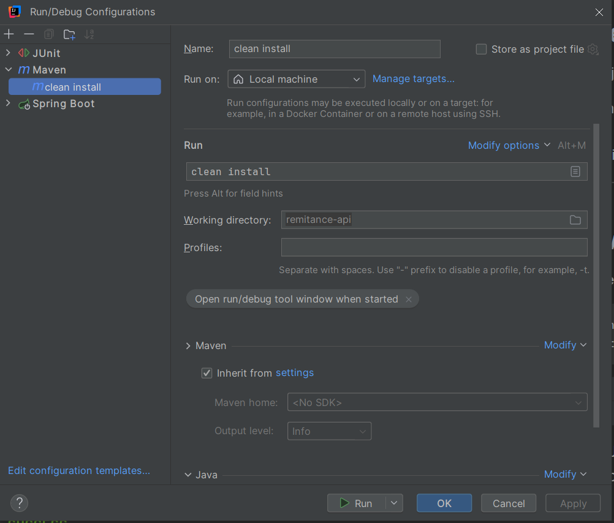
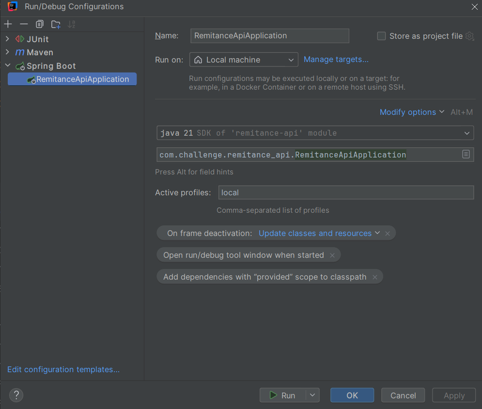
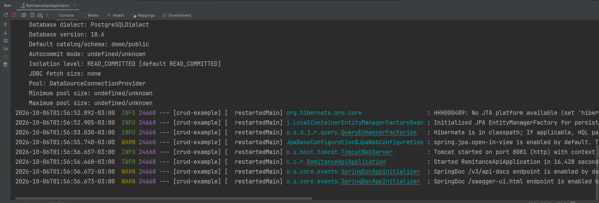
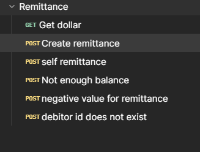

# Remittance API

REST API built with **Java Spring Boot** for secure processing of financial remittances and transfers between accounts, using clean architecture, a relational PostgreSQL database, and integration with an external exchange rate API.

## Technologies Used

* **Java 21** / **Spring Boot**
* **Spring Data JPA** (Persistence)
* **PostgreSQL** (Relational database)
* **RestClient** (External API integration for currency quotes)
* **Docker & Docker Compose** (Containerization and infrastructure)
* **Springdoc OpenAPI / Swagger** (API documentation)

---

## Prerequisites

To run this project locally, you will need:
* [Docker](https://www.docker.com/) and **Docker Compose** running.
* Java 21
* Postman

---
## Database
you can check it out the logical model on this [link](https://app.brmodeloweb.com/publicview/6ac483ad36b0d0a1170b37af)

or alternatively see the image below:


## How to Run the Project

1. **Clone the repository:**
   ```bash
   git clone https://github.com/RomarioBispo/remittance-challenge.git
   cd remitance-api
2. Inside intellij: Create a run configuration

3. Click on run so all dependencies will be downloaded and artifacts generated
4. Create another run configuration, this time for the application

5. Click on run, make sure you have set the "local" profile, docker and docker compose must be installed on your machine
6. This is sufficient to run locally and fire up the docker containers with the database and some database seed
7. When you get this screen everything was alright

8. You can go to the postman project folder, there you will find two files: the collection itself and the environment file, please import both on postman
9. After import a few scenarios will be shown

10. you can test all of them and add more if you want it
11. Application run in the 8081 port